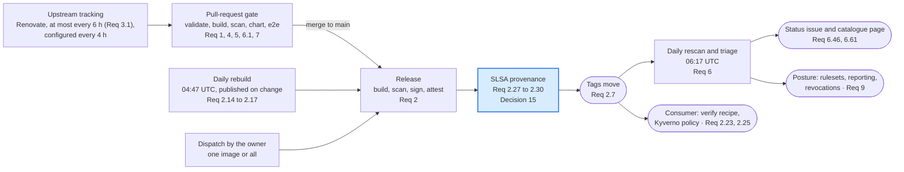
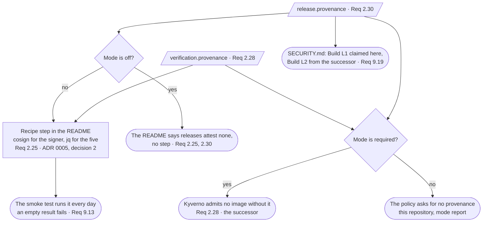

# The lanes: what runs, and why

The catalogue is a set of lanes: each is one path work takes through the repository, from a trigger to a published result. This page draws each lane once. A box is a step; its label names the requirement it fulfils (`Req n.m`, in [requirements.md](../.specs/dhc-catalogue-mvp/requirements.md)) and the design decision or ADR it rests on (`Decision n` in [design.md](../.specs/dhc-catalogue-mvp/design.md#key-design-decisions), ADRs in [docs/decisions/](decisions/)). A slanted box is a value declared in `catalogue-policy.yaml`, a diamond a branch on such a value, a rounded box an outcome. The table under each graph says where each step runs and where it is explained. GitHub draws the graphs; their text is in this file and changes in the pull request that changes the lane (Req 9.21).

Drill (Req 9.20, removed in the next commit): [a file that does not exist](./drill-no-such-file.md), [a heading that does not exist](#drill-no-such-heading).

## The lane map

How the lanes connect. The lanes not yet drawn below are drawn in the next steps of the documentation track; until then the [manual](user-manual.md#part-ii-the-pipeline) explains them.

## SLSA provenance

A provenance statement says who built a digest, from which repository, workflow file, branch and commit. Since 2026-11-18 every release made while the provenance mode is not `off` carries one beside the index and each platform manifest, generated and signed by GitHub's provenance service rather than written by the job, and the release checks it before any tag moves. These steps run only on `main`, after a push, a dispatch, or a scheduled rebuild that found a change and publishes; a pull request and a scheduled rebuild that publishes nothing never reach them. What it is for and the level claimed: [SECURITY.md](../SECURITY.md#slsa-build-level). The choice of service, verifier and storage: Decision 15 and [ADR 0005](decisions/0005-slsa-provenance-verifier.md). One switch, `release.provenance`, decides how much of the lane runs: `report` here, `required` in the successor, `off` for a repository GitHub offers no attestations to.

### At release

| Step | Runs in | Explained in | Rests on |
|---|---|---|---|
| Name the subjects | [`build.yml`](../.github/workflows/build.yml), step "name the provenance subjects"; [`unpack-provenance.sh subjects`](../scripts/unpack-provenance.sh) | [the release path](user-manual.md#the-release-path-merge-to-main-the-nightly-or-a-dispatch) | Req 2.27; Decision 15 |
| Attest | `build.yml`, step "attest provenance for the index and every platform manifest"; `actions/attest-build-provenance`, pinned by commit | [ADR 0005](decisions/0005-slsa-provenance-verifier.md) | Req 2.27; Decision 15, option B |
| Store | `build.yml`, step "store the provenance beside each digest"; [`unpack-provenance.sh store`](../scripts/unpack-provenance.sh) | [a release stopped at the provenance steps](user-manual.md#a-release-stopped-at-the-provenance-steps) | Req 2.27; ADR 0005, amendment of 2026-11-13: no bundle beside a digest, it hid the other attestations from cosign |
| Self-check | `build.yml`, step "verify the provenance of each digest"; [`check-provenance.sh verify`](../scripts/check-provenance.sh) | [what a provenance statement has to say](user-manual.md#what-a-provenance-statement-has-to-say) | Req 2.9, 2.28; ADR 0005, decisions 2 and 5 |
| Tags, or none | `build.yml`, step "apply definition-derived tags" | [the release path](user-manual.md#the-release-path-merge-to-main-the-nightly-or-a-dispatch) | Req 2.7, 2.9: any failure above moves no tag, consumers keep the previous digest |

### In the daily rescan

| Step | Runs in | Explained in | Rests on |
|---|---|---|---|
| Ask every reference | [`rescan.yml`](../.github/workflows/rescan.yml), step "provenance coverage over the supported set"; `check-provenance.sh report` or `require` | [provenance coverage in the status](user-manual.md#provenance-coverage-in-the-status) | Req 2.29; an absent statement never fails the run under `report`; what `require` and a check that cannot be made do is the SLSA track's FR-3 ([spec](../conductor/tracks/slsa-build-l2_20261028/spec.md)), the owner's call of 2026-11-19 |
| The status line | `rescan.yml`, step "catalogue status, the clocks over the supported set"; the status tool in [`triage/rescan`](../triage/rescan/) | [the catalogue status issue](user-manual.md#the-catalogue-status-issue) | Req 2.29, 2.30, 6.46, 6.47 |

### For a consumer

| Step | Runs in | Explained in | Rests on |
|---|---|---|---|
| The recipe step | the README's block, rendered by [`render-verification.sh`](../scripts/render-verification.sh) from the declaration | [verify an image](../README.md#verify-an-image) | Req 2.25; ADR 0005, decision 2: a step without the jq half verifies the signer only |
| The smoke test | `rescan.yml`, step "consumer smoke test"; [`consumer-smoke.sh`](../scripts/consumer-smoke.sh) | [reading job summaries](user-manual.md#reading-job-summaries) | Req 9.13; the review of 2026-09-09, finding 2.4: an empty result passed |
| The Kyverno rule | [`policies/verify-catalogue-images.yaml`](../policies/verify-catalogue-images.yaml), rendered only under `required` | [what a provenance statement has to say](user-manual.md#what-a-provenance-statement-has-to-say) | Req 2.28; ADR 0005, amendment: one more attestation of the existing entry |
| The claim | [SECURITY.md](../SECURITY.md#slsa-build-level) | the same | Req 9.19: no level above what the policy demands |
