# The lanes: what runs, and why

The catalogue is a set of lanes: each is one path work takes through the repository, from a trigger to a published result. This page draws each lane once. A box is a step; its label names the requirement it fulfils (`Req n.m`, in [requirements.md](../.specs/dhc-catalogue-mvp/requirements.md)) and the design decision or ADR it rests on (`Decision n` in [design.md](../.specs/dhc-catalogue-mvp/design.md#key-design-decisions), ADRs in [docs/decisions/](decisions/)). A slanted box is a value declared in `catalogue-policy.yaml`, a diamond a branch on such a value, a rounded box an outcome. The table under each graph says where each step runs and where it is explained. GitHub draws the graphs; their text is in this file and changes in the pull request that changes the lane (Req 9.21).

## The lane map

How the lanes connect. The lanes not yet drawn below are drawn in the next steps of the documentation track; until then the [manual](user-manual.md#part-ii-the-pipeline) explains them.

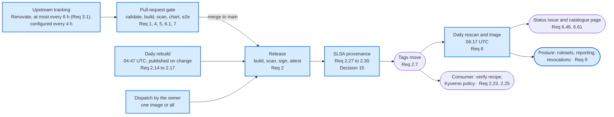

## Upstream tracking

This lane turns a new upstream release into a pull request, so nobody has to watch upstream by hand. Renovate (a bot that reads version pins and proposes updates) runs self-hosted in GitHub Actions every 4 hours, or when the owner dispatches it. It reads every pin in the repository, holds back what is too young or too big to offer, makes each bumped definition consistent again with a refresh script, and opens a pull request. That pull request then enters the [pull-request gate](user-manual.md#part-ii-the-pipeline) like any other change. Why Renovate and not a custom tracker: Decision 2. How much to trust an upstream release: Decision 8 and, for grafana, [ADR 0002](decisions/0002-grafana-upstream-tracking.md). Renovate cannot read `catalogue-policy.yaml`, so the two policy values it depends on reach it through a lint and a rendered block in `renovate.json5`.

### What is offered

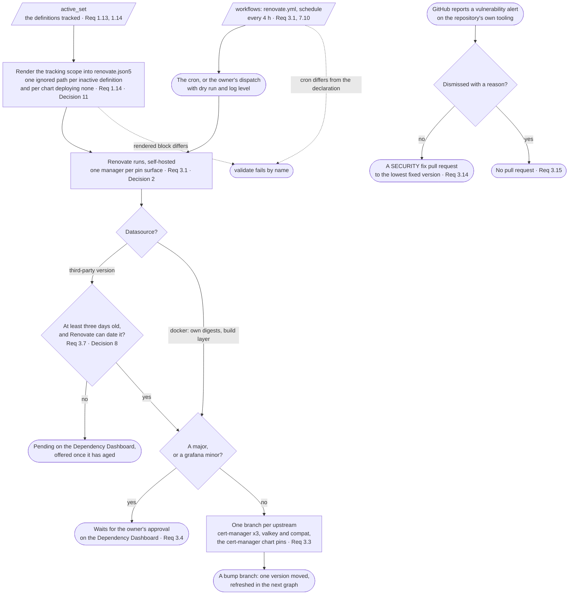

| Step | Runs in | Explained in | Rests on |
|---|---|---|---|
| The schedule | [`renovate.yml`](../.github/workflows/renovate.yml), `cron: "0 */4 * * *"`; held equal to the declaration by [`validate.yml`](../.github/workflows/validate.yml), step "workflow schedule + permissions vs policy file (Req 7.10)", [`lint-workflow-policy.sh`](../scripts/lint-workflow-policy.sh) | [crons and cadence](user-manual.md#crons-and-cadence) | Req 3.1 (at most 6 h; 4 h leaves margin for GitHub's scheduler delay), 7.10 |
| The tracking scope | [`render-tracking.sh`](../scripts/render-tracking.sh), run by whoever edits the active set; `validate.yml`, step "tracking scope rendering drift check (Req 1.14)" | [deactivate a definition](user-manual.md#deactivate-a-definition), [Renovate managers](user-manual.md#renovate-managers) | Req 1.13, 1.14; Decision 11 |
| Renovate runs | `renovate.yml`, its one step, which has no `name:`: `renovatebot/github-action` v43.0.9, pinned by commit; the managers in [`renovate.json5`](../renovate.json5) | [Renovate managers](user-manual.md#renovate-managers) | Req 3.1; Decision 2 |
| The age | `renovate.json5`, the rule with `minimumReleaseAge: "3 days"` and `timestamp-required` over github-tags, github-releases, npm, pypi, helm and go | [handling Renovate PRs](user-manual.md#handling-renovate-prs) | Req 3.7; Decision 8 (a): docker is exempt, it carries the catalogue's own digests and the hand-reviewed build layer |
| The dashboard | `renovate.json5`, the rules with `dependencyDashboardApproval: true`: every major, and every grafana minor | [handling Renovate PRs](user-manual.md#handling-renovate-prs) | Req 3.4; Decision 2: grafana rides the stable maintenance line, a minor is the owner's call (register row M24) |
| The grouping | `renovate.json5`, the three rules with a `groupName` naming one upstream | [Renovate managers](user-manual.md#renovate-managers) | Req 3.3 |
| The vulnerability alert | `renovate.json5`, `vulnerabilityAlerts: { enabled: true }` | [Renovate managers](user-manual.md#renovate-managers) | Req 3.14, 3.15: a dismissal in GitHub is the not-affected record for the repository's own dependencies |

### A bump made consistent

Renovate moves one value, the version. Every field derived from it (commit, checksum, tags, name) is then stale, so a script Renovate runs after the bump (a `postUpgradeTask`) rewrites them. Before it writes anything it checks the authenticity signal the definition declares in its `# authenticity:` comment, and a failed check writes nothing.


| Step | Runs in | Explained in | Rests on |
|---|---|---|---|
| Which pin moved | `renovate.json5`, the two `postUpgradeTasks` rules: one keyed on the github-tags datasource, one on the name `grafana/grafana`; both commands allowlisted in `renovate.yml` (`RENOVATE_ALLOWED_POST_UPGRADE_COMMANDS`) | [Renovate managers](user-manual.md#renovate-managers) | Decision 2: the two definition archetypes, compile-from-source and tarball-repackage |
| From-source refresh | [`refresh-definition.sh`](../scripts/refresh-definition.sh), inside the Renovate run; its tests: `validate.yml`, step "refresh-definition unit tests (postUpgradeTask, Req 3.2)" | [handling Renovate PRs](user-manual.md#handling-renovate-prs) | Req 3.2, 3.8; Decision 8 (b) |
| Grafana refresh | [`refresh-grafana.sh`](../scripts/refresh-grafana.sh), inside the Renovate run; its tests: `validate.yml`, step "refresh-grafana unit tests (postUpgradeTask, ADR 0002)" | [handling Renovate PRs](user-manual.md#handling-renovate-prs) (with the corner case of a build id no index carries yet, register M11) | Req 3.2, 3.8; ADR 0002 and its amendments of 2026-08-07, 2026-08-11 and 2026-08-25 |
| No task | the pin-script, Python and workflow-pin managers in `renovate.json5` | [handling Renovate PRs](user-manual.md#handling-renovate-prs): completing a tool-pin bump (register M1) | Req 7.5: a checksum that updates itself verifies nothing |

### Merged by a machine, or by the owner

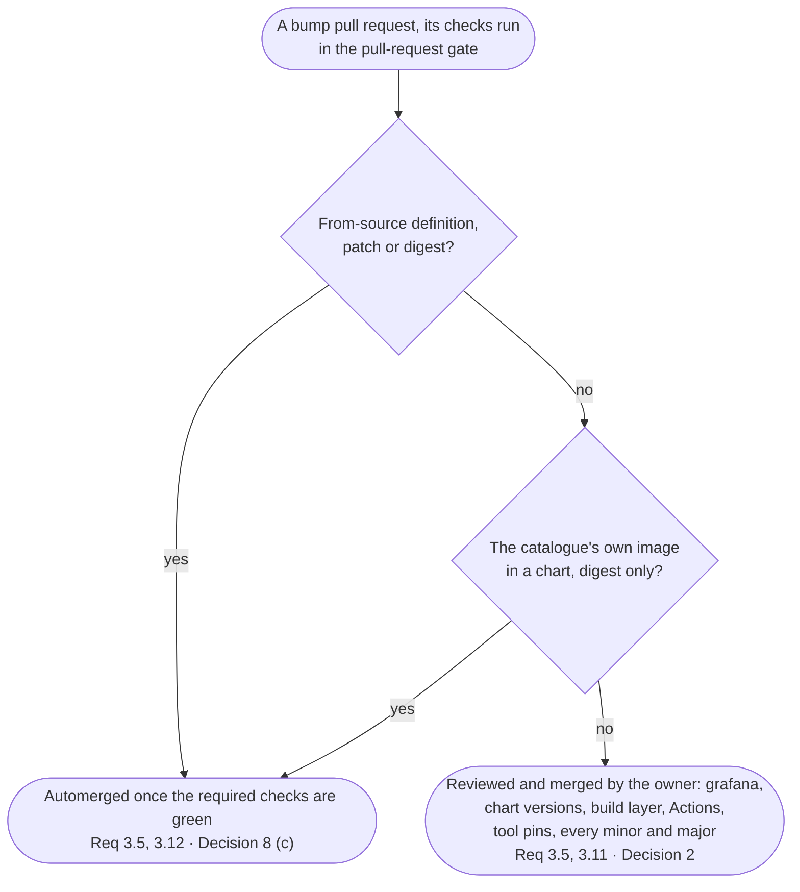

| Step | Runs in | Explained in | Rests on |
|---|---|---|---|
| From-source automerge | `renovate.json5`, the rule `matchDatasources: ["github-tags"]` with `matchUpdateTypes: ["patch", "digest"]`; the later rule `matchManagers: ["github-actions"]` takes Actions back out | [handling Renovate PRs](user-manual.md#handling-renovate-prs) | Req 3.5; Decision 2: Actions are third-party code holding the workflow's token (review D4) |
| Chart digest automerge | `renovate.json5`, the rule over `ghcr.io/mm-weber/dhc/**` with `matchUpdateTypes: ["digest"]`, ordered before the build-layer rule | [handling Renovate PRs](user-manual.md#handling-renovate-prs) | Req 3.12; Decision 8 (c) |
| Reviewed | `renovate.json5`, `automerge: false` on grafana, the helm datasource, the build layer and the Actions manager; no automerge rule reaches the rest | [handling Renovate PRs](user-manual.md#handling-renovate-prs) | Req 3.11; Decision 2: a repackage bump swaps a binary this repository did not build |

## The pull-request gate

This lane decides whether a change may reach `main`. Every pull request starts it, whether a person or Renovate opened it, and so does every push to an open pull request. Four workflows run side by side: `validate` checks conventions and declared values and runs every test suite, `build` builds and scans each definition the change touches, `chart` renders every chart and checks it against the Kyverno policies, and `e2e` installs each touched chart on a throwaway Kubernetes cluster. It produces no image and no tag: its result is five check results, and the branch ruleset admits the merge only when all five are green. The merge then starts the [release](user-manual.md#the-release-path-merge-to-main-the-nightly-or-a-dispatch) on `main`. Two step names in `build.yml` contain a long dash; the tables below print it as a colon.

### What must be green

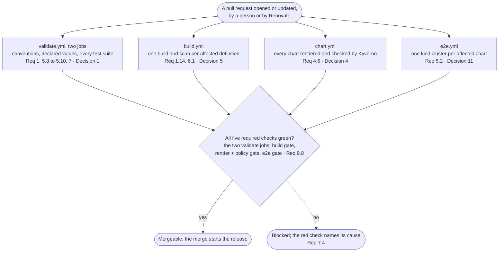

| Step | Runs in | Explained in | Rests on |
|---|---|---|---|
| The four workflows | [`validate.yml`](../.github/workflows/validate.yml), [`build.yml`](../.github/workflows/build.yml), [`chart.yml`](../.github/workflows/chart.yml), [`e2e.yml`](../.github/workflows/e2e.yml), each `on: pull_request` | [the six workflows](user-manual.md#the-six-workflows) | Req 7.2, 7.4 |
| The required checks | [`.github/rulesets/main_sec.json`](../.github/rulesets/main_sec.json), `required_status_checks`: the job names "yamllint, pin lint, policy tests", "go modules (e2e + rescan tool)", "build gate", "render + policy gate", "e2e gate" | [branch protection](user-manual.md#branch-protection) | Req 9.8: a matrix leg has a name per image, so only the fan-in jobs can be required |

### validate: the declared values

These steps hold the repository to what `catalogue-policy.yaml` declares. Each fails naming the value, file or entry that differs.

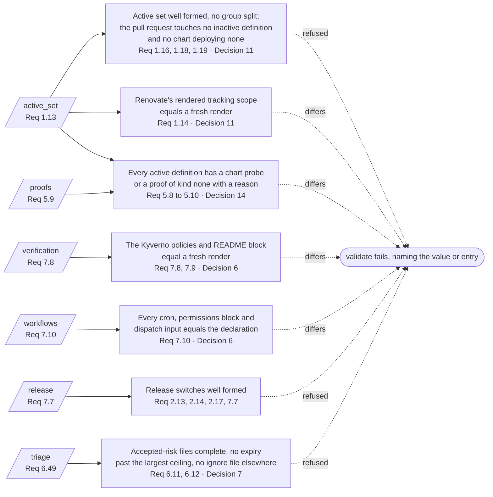

| Step | Runs in | Explained in | Rests on |
|---|---|---|---|
| Active set | `validate.yml`, step "active-set coherence and scope (Req 1.16, 1.18, 1.19)"; [`lint-active-set.sh`](../scripts/lint-active-set.sh) with `--changed`, the files the pull request changes against its base | [deactivate a definition](user-manual.md#deactivate-a-definition) | Req 1.16, 1.18, 1.19; Decision 11 |
| Tracking scope | `validate.yml`, step "tracking scope rendering drift check (Req 1.14)"; [`render-tracking.sh --check`](../scripts/render-tracking.sh) | [Renovate managers](user-manual.md#renovate-managers) | Req 1.14; Decision 11 |
| Functional proofs | `validate.yml`, step "every active definition declares a functional proof (Req 5.8 to 5.10)"; [`lint-probes.sh`](../scripts/lint-probes.sh), which also prints each kind none entry by name | [e2e, the kind suite](user-manual.md#e2e--the-kind-suite) | Req 5.8 to 5.10; Decision 14 |
| Verification renderings | `validate.yml`, step "verification renderings drift check (Req 7.8, 7.9)"; [`render-verification.sh --check`](../scripts/render-verification.sh) | [policies](user-manual.md#policies) | Req 7.8, 7.9; Decision 6 |
| Workflow values | `validate.yml`, step "workflow schedule + permissions vs policy file (Req 7.10)"; [`lint-workflow-policy.sh`](../scripts/lint-workflow-policy.sh) | [crons and cadence](user-manual.md#crons-and-cadence) | Req 7.10; Decision 6 |
| Release switches | `validate.yml`, step "release switches well-formed (Req 2.13, 2.14, 2.17, 7.7)"; [`release-policy.sh check`](../scripts/release-policy.sh), the reader `build.yml` uses too | [the release path](user-manual.md#the-release-path-merge-to-main-the-nightly-or-a-dispatch) | Req 7.7; review D3: a misspelt value is refused, not read as the fail-open branch |
| Accepted-risk lint | `validate.yml`, step "accepted-risk lint for the risk treatment lane (Req 6.11, 6.12)"; [`lint-accepted-risk.sh`](../scripts/lint-accepted-risk.sh) | [writing an accepted-risk exception](user-manual.md#writing-an-accepted-risk-exception) | Req 6.11, 6.12; Decision 7 |

### validate: conventions and suites

The rest of `validate` reads no policy value. It runs in two jobs, and each is one required check.

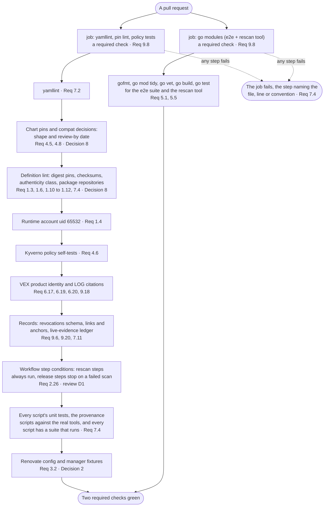

The boxes group the job's steps by subject; in the workflow they run in a slightly different order, the declared-value checks above among them.

| Step | Runs in | Explained in | Rests on |
|---|---|---|---|
| yamllint | `validate.yml`, step "yamllint (Req 7.2)", over every YAML file, not only changed ones | [validate, the lint battery](user-manual.md#validate--the-lint-battery) | Req 7.2 |
| Chart pins and compat | `validate.yml`, step "chart pins and compat decisions (Req 4.5, 4.8)"; `yamale` and [`lint-compat.sh`](../scripts/lint-compat.sh) | [adapt a chart](user-manual.md#adapt-a-chart) | Req 4.5, 4.8; Decision 8 |
| Definition lint | `validate.yml`, step "pin + definition lint against docs/CONVENTIONS.md (Req 1.6, 7.2, 7.4)"; [`lint-pins.sh`](../scripts/lint-pins.sh) | [validate, the lint battery](user-manual.md#validate--the-lint-battery), [CONVENTIONS.md](CONVENTIONS.md) | Req 1.3, 1.6, 1.10 to 1.12, 7.4; Decision 8. The schema half of Req 7.2 is the frontend compiling the definition in `build.yml` (Decision 1) |
| Runtime account | `validate.yml`, step "runtime account lint (Req 1.4)"; [`lint-accounts.sh`](../scripts/lint-accounts.sh) | [add an image definition](user-manual.md#add-an-image-definition) | Req 1.4 |
| Kyverno self-tests | `validate.yml`, step "kyverno policy tests (Req 4.6 gate self-test)" | [policies](user-manual.md#policies) | Req 4.6 |
| VEX lints | `validate.yml`, steps "VEX product identity lint (Req 6.17, 6.19, 6.20)" and "VEX statement LOG citations (Req 9.18)"; [`lint-vex-product.sh`](../scripts/lint-vex-product.sh), [`lint-log-anchors.sh`](../scripts/lint-log-anchors.sh) | [writing a VEX statement](user-manual.md#writing-a-vex-statement) | Req 6.17, 6.19, 6.20, 9.18 |
| Records | `validate.yml`, steps "revocation record (Req 9.6)", "relative links and heading anchors resolve (Req 9.20)", "live-evidence ledger covers every criterion (Req 7.11)" | [revoke a digest](user-manual.md#revoke-a-digest), [validate, the lint battery](user-manual.md#validate--the-lint-battery), [live-evidence.md](live-evidence.md) | Req 9.6, 9.20, 7.11 |
| Step conditions | `validate.yml`, steps "rescan steps run regardless of earlier failures (D1)" and "release steps stay stopped by a failed scan (Req 2.26)" | [reading job summaries](user-manual.md#reading-job-summaries) | Req 2.26; review D1 of 2026-09-09 |
| Suites | `validate.yml`, one step per `scripts/*_test.sh`, then "install the pinned crane and cosign for the real-tool suite (Req 7.5)", "provenance scripts against the real crane and cosign (Req 2.27, 2.28)" and "every script has a test suite, and every suite runs here" | [scripts](user-manual.md#scripts) | Req 7.4; review D7: a suite that never runs in CI proves nothing |
| Renovate fixtures | `validate.yml`, step "renovate config + manager fixtures" | [Renovate managers](user-manual.md#renovate-managers) | Req 3.2; Decision 2 |
| Go modules | `validate.yml`, job "go modules (e2e + rescan tool)": steps "gofmt", "go.mod and go.sum are what go mod tidy would write", "go vet", "go build (compiles suite + helpers)", "helper unit tests", and the four "rescan tool" steps | [validate, the lint battery](user-manual.md#validate--the-lint-battery) | Req 5.1; Req 5.5 and 5.8 through `TestProbeDeclarations`, every declared probe registered |

### build: which definitions

`build.yml` first works out which definitions the pull request touches, and builds only those. The `changes` job does this; the `build gate` job at the end is the one check branch protection can require.

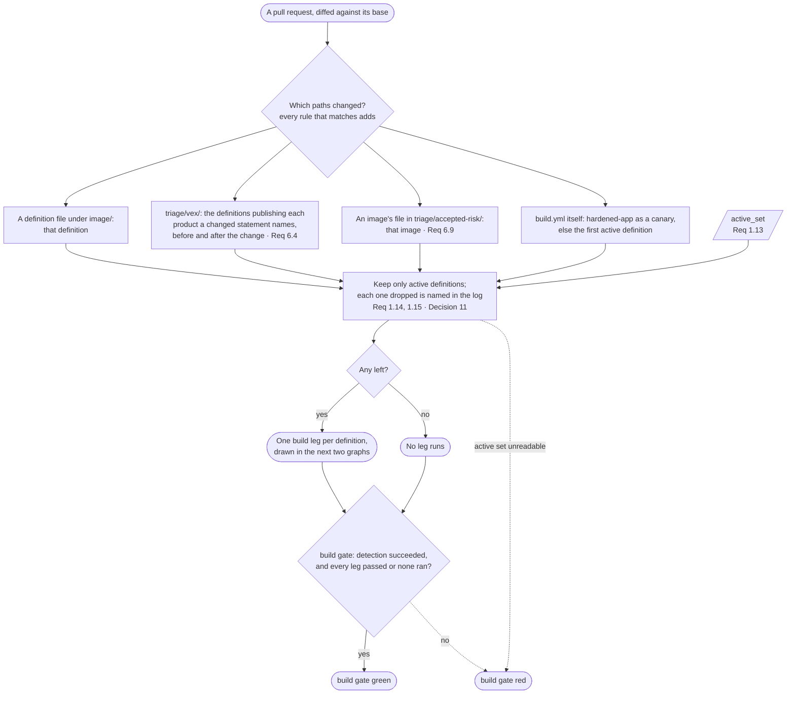

| Step | Runs in | Explained in | Rests on |
|---|---|---|---|
| Which paths changed | [`build.yml`](../.github/workflows/build.yml), job "affected definitions", its one step (`id: detect`, no `name:`), the `pull_request` branch | [build, the scan gate](user-manual.md#build--the-scan-gate), item 1 | Req 6.4, 6.9: a statement or exception change re-proves itself on the images it names |
| Keep only active ones | the same step, after the branches; `active_definitions` in [`definition-lib.sh`](../scripts/definition-lib.sh) | [deactivate a definition](user-manual.md#deactivate-a-definition) | Req 1.14, 1.15; Decision 11. `validate` fails such a pull request separately (Req 1.16) |
| The fan-in | `build.yml`, job "build gate", its one step (no `name:`) | [branch protection](user-manual.md#branch-protection) | Req 9.8: "skipped" passes only when detection itself succeeded |

### build: one definition on a pull request

Each leg builds one definition for linux/amd64 only and loads it into the runner's Docker daemon. Nothing reaches the catalogue registry: the only push goes to a registry that lives on the runner for the length of the job.

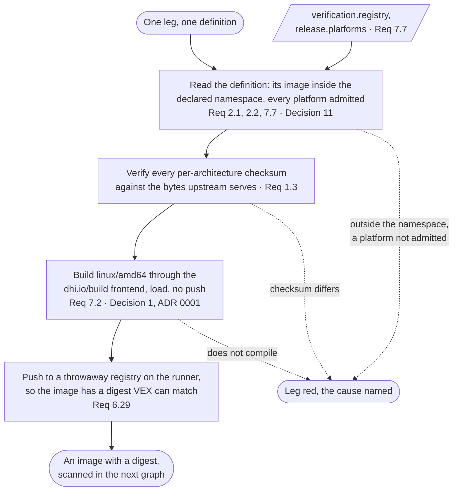

| Step | Runs in | Explained in | Rests on |
|---|---|---|---|
| Read the definition | [`build.yml`](../.github/workflows/build.yml), job "build ${{ matrix.name }}", the step `id: meta` (no `name:`); [`release-policy.sh`](../scripts/release-policy.sh) | [build, the scan gate](user-manual.md#build--the-scan-gate), item 3 | Req 2.1, 2.2, 7.7; Decision 11. It runs on every event, so a pull request is refused the same way a release would be |
| Build | `build.yml`, the step `id: build` (no `name:`), `docker/build-push-action` with `platforms: linux/amd64` and `load: true` on a pull request | [anatomy of a DHI definition](user-manual.md#anatomy-of-a-dhi-definition) | Req 7.2 (the frontend is the schema check); Decision 1, [ADR 0001](decisions/0001-build-layer.md) |
| Local registry | `build.yml`, step "local registry: give the image an identity VEX can match" | [build, the scan gate](user-manual.md#build--the-scan-gate), item 4 | Req 6.29; Trivy builds the product identifier from the digest a push mints (upstream trivy#9399) |

### build: the scan and the decision

Only the last step fails the leg on a finding; the one before it fails on an exception that outlives its ceiling. An expired exception covers nothing, so its finding counts. Two earlier steps are evidence: when they fail, the step shows red and the leg goes on.

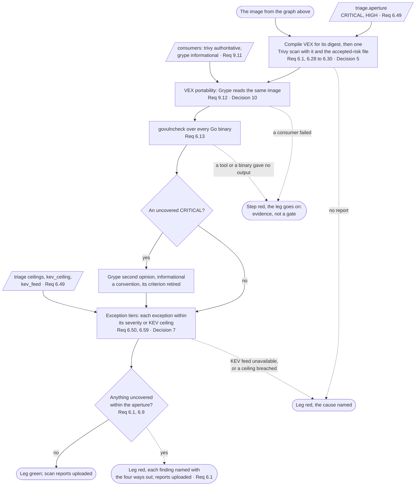

| Step | Runs in | Explained in | Rests on |
|---|---|---|---|
| Compile and scan | `build.yml`, step "Trivy scan (VEX + accepted risk)"; [`compile-vex.sh`](../scripts/compile-vex.sh), [`scan-image.sh`](../scripts/scan-image.sh), the same script the release scan uses | [writing a VEX statement](user-manual.md#writing-a-vex-statement), [reading job summaries](user-manual.md#reading-job-summaries) | Req 6.1, 6.26 to 6.30; Decision 5, [ADR 0003](decisions/0003-one-openvex-document-per-digest.md) |
| VEX portability | `build.yml`, step "VEX portability (Req 9.12)", `continue-on-error: true`; [`vex-consumer.sh`](../scripts/vex-consumer.sh), [`vex-portability.sh`](../scripts/vex-portability.sh) | [reading job summaries](user-manual.md#reading-job-summaries) | Req 9.11, 9.12; Decision 10: `consumers.gating` is off, so a divergence is reported, never failed |
| govulncheck | `build.yml`, step "govulncheck reachability (Req 6.13)", `continue-on-error: true`; [`govulncheck-report.sh`](../scripts/govulncheck-report.sh) | [reachability evidence](user-manual.md#reachability-evidence-govulncheck) | Req 6.13; review D3: a tool that gave no output fails the step by name |
| Grype | `build.yml`, step "Grype second opinion (CRITICAL present)", run only when Trivy left a CRITICAL uncovered | [build, the scan gate](user-manual.md#build--the-scan-gate), item 7 | A convention: its criterion, Req 6.6, is retired |
| Exception tiers | `build.yml`, step "exception tiers against KEV (Req 6.50)"; [`check-exceptions.sh gate`](../scripts/check-exceptions.sh) with the KEV feed fetched fresh | [writing an accepted-risk exception](user-manual.md#writing-an-accepted-risk-exception) | Req 6.50, 6.59; Decision 7: an unavailable feed fails closed, by name |
| The scan gate | `build.yml`, step "Scan gate: fail on uncovered findings within the aperture" | [clearing a red gate](user-manual.md#clearing-a-red-gate--the-four-treatments) | Req 6.1, 6.9 (Trivy drops an expired ignore entry, so its finding counts); Decision 5 |
| Reports | `build.yml`, step "upload scan reports", `if: always()` | [reading job summaries](user-manual.md#reading-job-summaries) | Req 6.26, 6.27: the summary names what each exception suppressed |

### chart: every chart, every time

`chart.yml` does not ask what changed: every directory under `chart/` is rendered and checked on every pull request. Installing a chart on a cluster is the next graph's job.

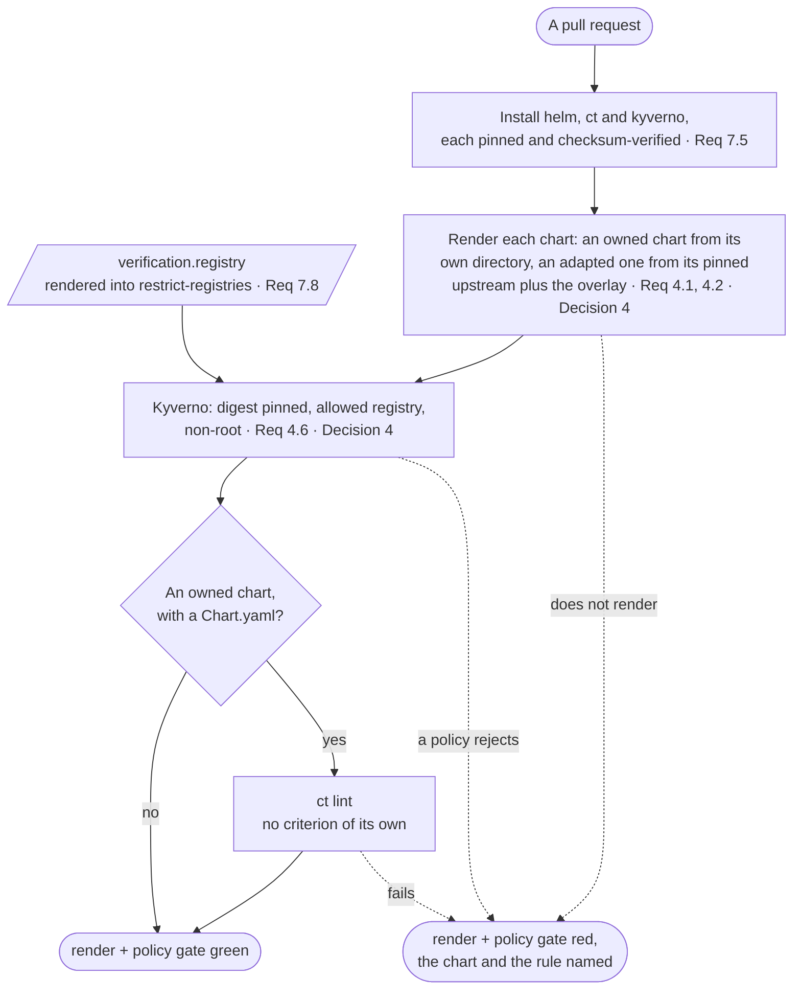

| Step | Runs in | Explained in | Rests on |
|---|---|---|---|
| Tools | [`chart.yml`](../.github/workflows/chart.yml), job "render + policy gate", step "install helm + ct + kyverno"; [`install-tool.sh`](../scripts/install-tool.sh) | [the six workflows](user-manual.md#the-six-workflows) | Req 7.5 |
| Render and check | `chart.yml`, step "render every chart and gate with kyverno (Req 4.6)"; [`render-chart.sh`](../scripts/render-chart.sh), the three policies `require-image-digest`, `restrict-registries`, `require-nonroot` under [`policies/`](../policies/) | [chart, render + policy gate](user-manual.md#chart--render--policy-gate) | Req 4.1, 4.2, 4.6; Decision 4 |
| ct lint | `chart.yml`, step "ct lint owned charts" | [chart, render + policy gate](user-manual.md#chart--render--policy-gate) | No criterion of its own: the chart-testing tool's lint, for the charts this repository owns |

### e2e: the touched charts on a real cluster

`e2e.yml` installs each touched chart on a fresh kind cluster (Kubernetes running inside Docker on the runner). The pods pull the catalogue images the chart pins, which are published digests: a pull request that changes a definition tests its chart with the image already released, and the new image is tested when the chart-pin bump after its release comes through this lane.

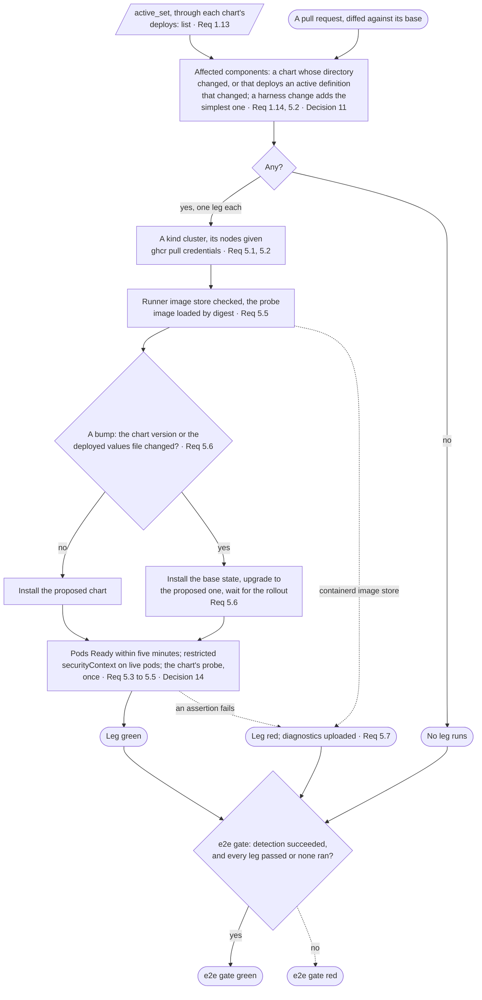

| Step | Runs in | Explained in | Rests on |
|---|---|---|---|
| Affected components | [`e2e.yml`](../.github/workflows/e2e.yml), job "affected components", its one step (`id: detect`, no `name:`); `active_components` in [`definition-lib.sh`](../scripts/definition-lib.sh) | [e2e, the kind suite](user-manual.md#e2e--the-kind-suite) | Req 1.14, 5.2; Decision 11: a definition reaches its chart through `deploys:`, never a name prefix |
| Cluster | `e2e.yml`, job "e2e ${{ matrix.component }}", steps "install helm + kind", "create kind cluster", "give kind nodes ghcr pull credentials" | [e2e, the kind suite](user-manual.md#e2e--the-kind-suite) | Req 5.1, 5.2: the charts pin the index digest, which a loaded image cannot match |
| Image store and probe image | `e2e.yml`, steps "runner image and image store (kind issue 3795)", [`check-runner-image-store.sh`](../scripts/check-runner-image-store.sh), and "load probe image into kind" | [e2e, the kind suite](user-manual.md#e2e--the-kind-suite) | Req 5.5 (the probe's image); the job is pinned to `ubuntu-24.04` until kind can load from the containerd store |
| Bump or not | `e2e.yml`, step "compute upgrade-from on a bump" | [e2e, the kind suite](user-manual.md#e2e--the-kind-suite) | Req 5.6 |
| The suite | `e2e.yml`, step "run e2e suite", `go test ./e2e/` with `DHC_E2E=1`; the Ginkgo specs under [`test/e2e/`](../test/e2e/) | [e2e, the kind suite](user-manual.md#e2e--the-kind-suite) | Req 5.3 to 5.6; Decision 14: one probe per chart, standing for every definition it deploys |
| Diagnostics | `e2e.yml`, steps "collect diagnostics on failure", "upload diagnostics", then "delete kind cluster" | [e2e, the kind suite](user-manual.md#e2e--the-kind-suite) | Req 5.7 |
| The fan-in | `e2e.yml`, job "e2e gate", its one step (no `name:`) | [branch protection](user-manual.md#branch-protection) | Req 9.8 |

## The release

This lane turns a definition into a published image: one that carries tags, a signature, SBOMs, a VEX document and scan reports. It runs in `build.yml` on `main` and has three entries: a merge to `main` that changes a definition, the daily rebuild at 04:47 UTC, and a dispatch by the owner naming one image or none (none means every active definition). The daily rebuild first builds locally and publishes only when the packages inside changed. Every release pushes the image by digest (its content address) with no tag, scans exactly that digest, signs and attests it, and moves the tags last. Why this order: Decision 6, "publish with status". The provenance steps between the attestations and the tags are drawn once, in the [SLSA provenance](#slsa-provenance) lane.

### Which definitions

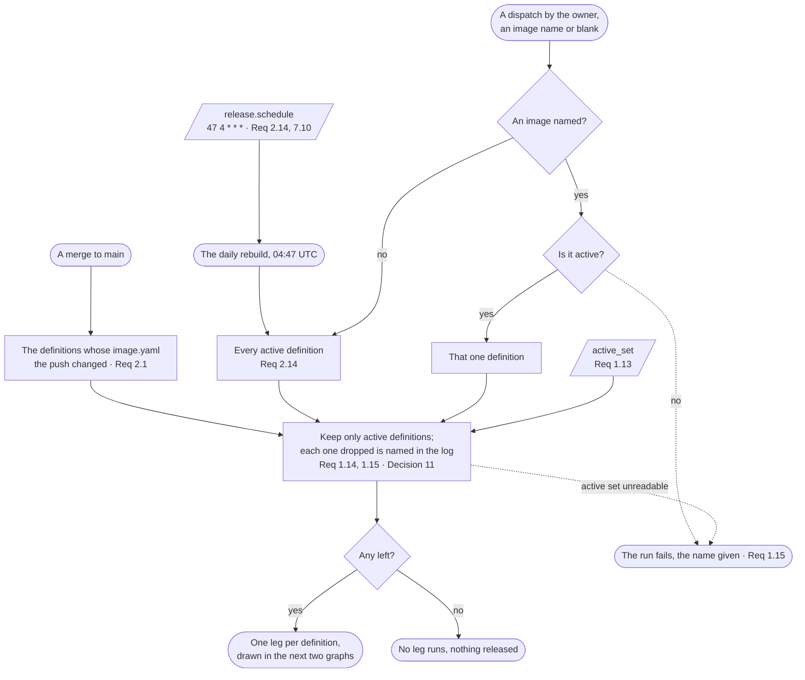

| Step | Runs in | Explained in | Rests on |
|---|---|---|---|
| The three entries | [`build.yml`](../.github/workflows/build.yml), `on: push: branches: [main]`, `schedule: cron: "47 4 * * *"` and `workflow_dispatch` with the free-text input `image`; cron and input held equal to `catalogue-policy.yaml` by `validate.yml`, step "workflow schedule + permissions vs policy file (Req 7.10)" | [crons and cadence](user-manual.md#crons-and-cadence), [the release path](user-manual.md#the-release-path-merge-to-main-the-nightly-or-a-dispatch) | Req 2.1, 2.14, 7.10; Decision 6 |
| Which definitions | `build.yml`, job "affected definitions", its one step (`id: detect`, no `name:`): on a push, the `image/*/image.yaml` files changed between the previous and the new head; on the schedule, the whole active set; on a dispatch, the named image or the whole active set | [the release path](user-manual.md#the-release-path-merge-to-main-the-nightly-or-a-dispatch) | Req 2.1, 2.14. A merge that changes only a VEX statement, an exception or a chart releases nothing; the daily rescan carries a VEX change to the published digests |
| Keep only active ones | the same step, after the branches; `active_definitions` in [`definition-lib.sh`](../scripts/definition-lib.sh) | [deactivate a definition](user-manual.md#deactivate-a-definition) | Req 1.14, 1.15; Decision 11 |

### One definition: built, or discarded by the nightly

Each leg runs the job "build ${{ matrix.name }}". The scheduled rebuild builds locally first and asks whether anything a consumer could receive has changed; a merge and a dispatch never ask.

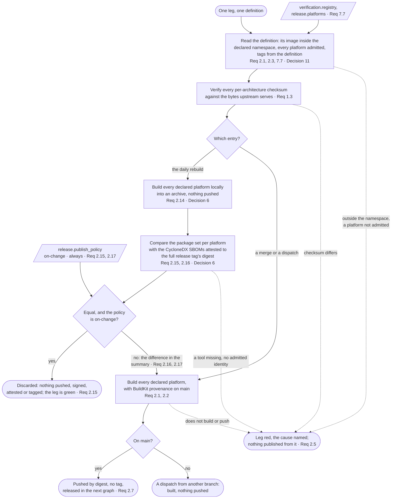

| Step | Runs in | Explained in | Rests on |
|---|---|---|---|
| Read the definition | [`build.yml`](../.github/workflows/build.yml), the step `id: meta` (no `name:`); [`release-policy.sh`](../scripts/release-policy.sh) reads the switches and the admitted platforms | [the release path](user-manual.md#the-release-path-merge-to-main-the-nightly-or-a-dispatch), item 4 | Req 2.1, 2.3, 7.7; Decision 11 |
| Checksums | `build.yml`, step "verify per-arch pinned checksums"; [`verify-arch-pins.sh`](../scripts/verify-arch-pins.sh) | [build, the scan gate](user-manual.md#build--the-scan-gate) | Req 1.3: the pull request builds amd64 only, so an arm64 pin is first exercised here |
| Local build | `build.yml`, step "scheduled rebuild, local only (Req 2.14)", `if: github.event_name == 'schedule'` | [the release path](user-manual.md#the-release-path-merge-to-main-the-nightly-or-a-dispatch), "The nightly" | Req 2.14; Decision 6 |
| The comparison | `build.yml`, step "publish-on-change comparator (Req 2.15-2.17)"; [`package-set-diff.sh`](../scripts/package-set-diff.sh), read through `cosign verify-attestation` against the admitted identities; verdict `equal` or `different` with a reason, each of which publishes (`package-set-differs`, `no-published-digest`, `attestation-unreadable`, `platform-set-differs`); cosign is installed before it by step "install cosign and crane" | [the release path](user-manual.md#the-release-path-merge-to-main-the-nightly-or-a-dispatch), "The nightly" | Req 2.15 to 2.17; Decision 6, its reproducibility paragraph: package type, name, version and pull checksum, never SBOM bytes. Only proven equality discards; a missing tool is a refusal, not a difference |
| Build and push | `build.yml`, the step `id: build` (no `name:`), `docker/build-push-action` with `provenance: mode=max` and, on `main` only, `push-by-digest=true`; skipped when the comparator discarded | [the release path](user-manual.md#the-release-path-merge-to-main-the-nightly-or-a-dispatch), item 1 | Req 2.1, 2.2, 2.7; Decision 6. A failure in one leg leaves the other legs running (`fail-fast: false`) |

### One definition: scanned, signed, tagged

Every step here runs only on `main`, and on the schedule only when the comparator said publish. A failed step skips every step after it, so a digest stopped here stays pushed but untagged: frozen, pullable by digest only.

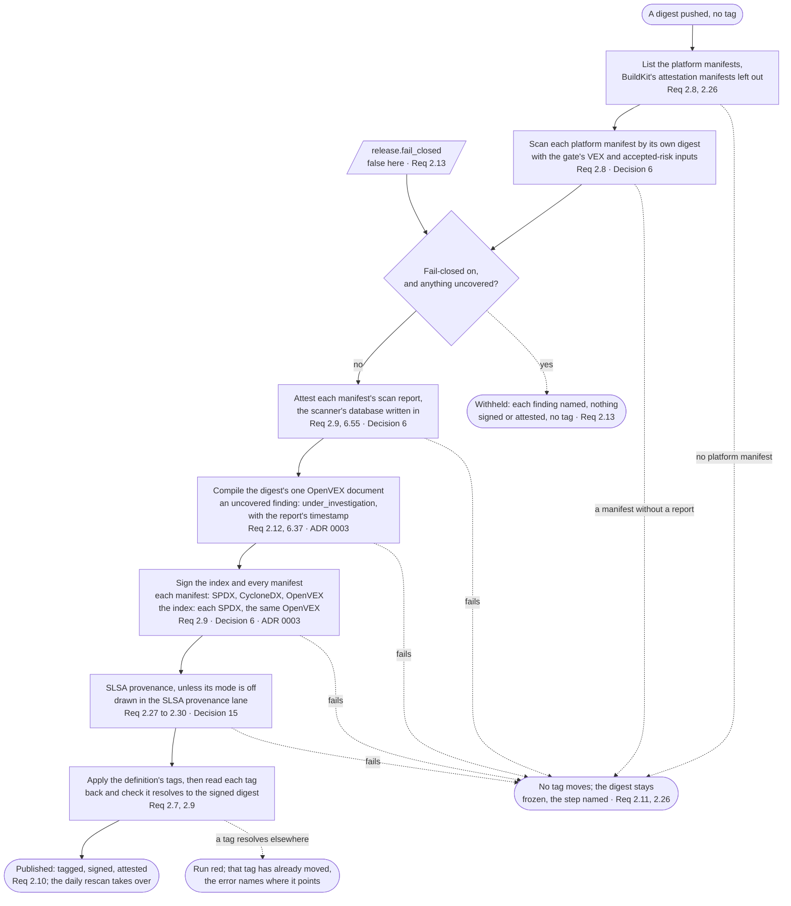

| Step | Runs in | Explained in | Rests on |
|---|---|---|---|
| Platform manifests | [`build.yml`](../.github/workflows/build.yml), step "enumerate platform manifests" | [the release path](user-manual.md#the-release-path-merge-to-main-the-nightly-or-a-dispatch), item 2 | Req 2.8, 2.26 and the Terms of Req 2: a manifest under `unknown/unknown` or with a reference-type annotation is BuildKit's, not a platform |
| Release-time scan | `build.yml`, step "release-time scan of the pushed digest (Req 2.8)"; [`compile-vex.sh`](../scripts/compile-vex.sh) for the source statements, then [`scan-image.sh`](../scripts/scan-image.sh) `--remote`, the script the gate uses | [the release path](user-manual.md#the-release-path-merge-to-main-the-nightly-or-a-dispatch), item 3 | Req 2.8, 2.26; Decision 6: scan what you sign. That later steps stay skipped after a failed scan is checked by `validate.yml`, step "release steps stay stopped by a failed scan (Req 2.26)" |
| Fail-closed | `build.yml`, step "fail-closed release gate (Req 2.13)", run only when the switch is on and the scan left a finding uncovered | [the release path](user-manual.md#the-release-path-merge-to-main-the-nightly-or-a-dispatch), item 4 | Req 2.13; Decision 6: off by default, option B of that decision was rejected |
| Scan reports | `build.yml`, step "attest each platform manifest's scan report (Req 2.9)": `trivy convert --format cosign-vuln`, [`fill-scanner-db.sh`](../scripts/fill-scanner-db.sh), `cosign attest --type vuln` | [the release path](user-manual.md#the-release-path-merge-to-main-the-nightly-or-a-dispatch), item 5 | Req 2.9, 6.55; Decision 6, "scan reports are attested" |
| The OpenVEX document | `build.yml`, step "compile the digest's OpenVEX document (Req 2.12, 6.37)"; `compile-vex.sh` a second time, with the scan reports | [writing a VEX statement](user-manual.md#writing-a-vex-statement) | Req 2.12, 6.37; [ADR 0003](decisions/0003-one-openvex-document-per-digest.md): one document per digest, empty when nothing applies. The rescan later replaces it, never adds a second ([ADR 0004](decisions/0004-re-attestation-replaces.md)) |
| Sign and attest | `build.yml`, step "sign and attest (Req 2.9)": `cosign sign --recursive` on the index; Syft's SBOMs and each `cosign attest` made per target, not by `--recursive` | [the release path](user-manual.md#the-release-path-merge-to-main-the-nightly-or-a-dispatch), item 7 | Req 2.9; Decision 6; ADR 0003 |
| Provenance | the four steps from "name the provenance subjects (Req 2.27)" to "verify the provenance of each digest (Req 2.9, 2.28)" | [SLSA provenance](#slsa-provenance), the graph "At release" | Req 2.27 to 2.30; Decision 15 |
| Tags | `build.yml`, step "apply definition-derived tags (Req 2.7, 2.9)": `docker buildx imagetools create` with every tag, then `imagetools inspect` per tag | [the release path](user-manual.md#the-release-path-merge-to-main-the-nightly-or-a-dispatch), item 9 | Req 2.7, 2.9, 2.10. The check runs after the tags are written, so a mismatch leaves that tag moved, not untouched |
| The fan-in | `build.yml`, job "build gate", its one step (no `name:`), on `main` as on a pull request | [branch protection](user-manual.md#branch-protection) | Req 9.8: a red leg makes the run's build gate red |

## SLSA provenance

A provenance statement says who built a digest, from which repository, workflow file, branch and commit. Since 2026-11-18 every release made while the provenance mode is not `off` carries one beside the index and each platform manifest, generated and signed by GitHub's provenance service rather than written by the job, and the release checks it before any tag moves. These steps run only on `main`, after a push, a dispatch, or a scheduled rebuild that found a change and publishes; a pull request and a scheduled rebuild that publishes nothing never reach them. What it is for and the level claimed: [SECURITY.md](../SECURITY.md#slsa-build-level). The choice of service, verifier and storage: Decision 15 and [ADR 0005](decisions/0005-slsa-provenance-verifier.md). One switch, `release.provenance`, decides how much of the lane runs: `report` here, `required` in the successor, `off` for a repository GitHub offers no attestations to.

### At release


| Step | Runs in | Explained in | Rests on |
|---|---|---|---|
| Name the subjects | [`build.yml`](../.github/workflows/build.yml), step "name the provenance subjects"; [`unpack-provenance.sh subjects`](../scripts/unpack-provenance.sh) | [the release path](user-manual.md#the-release-path-merge-to-main-the-nightly-or-a-dispatch) | Req 2.27; Decision 15 |
| Attest | `build.yml`, step "attest provenance for the index and every platform manifest"; `actions/attest-build-provenance`, pinned by commit | [ADR 0005](decisions/0005-slsa-provenance-verifier.md) | Req 2.27; Decision 15, option B |
| Store | `build.yml`, step "store the provenance beside each digest"; [`unpack-provenance.sh store`](../scripts/unpack-provenance.sh) | [a release stopped at the provenance steps](user-manual.md#a-release-stopped-at-the-provenance-steps) | Req 2.27; ADR 0005, amendment of 2026-11-13: no bundle beside a digest, it hid the other attestations from cosign |
| Self-check | `build.yml`, step "verify the provenance of each digest"; [`check-provenance.sh verify`](../scripts/check-provenance.sh) | [what a provenance statement has to say](user-manual.md#what-a-provenance-statement-has-to-say) | Req 2.9, 2.28; ADR 0005, decisions 2 and 5 |
| Tags, or none | `build.yml`, step "apply definition-derived tags" | [the release path](user-manual.md#the-release-path-merge-to-main-the-nightly-or-a-dispatch) | Req 2.7, 2.9: any failure above moves no tag, consumers keep the previous digest |

### In the daily rescan

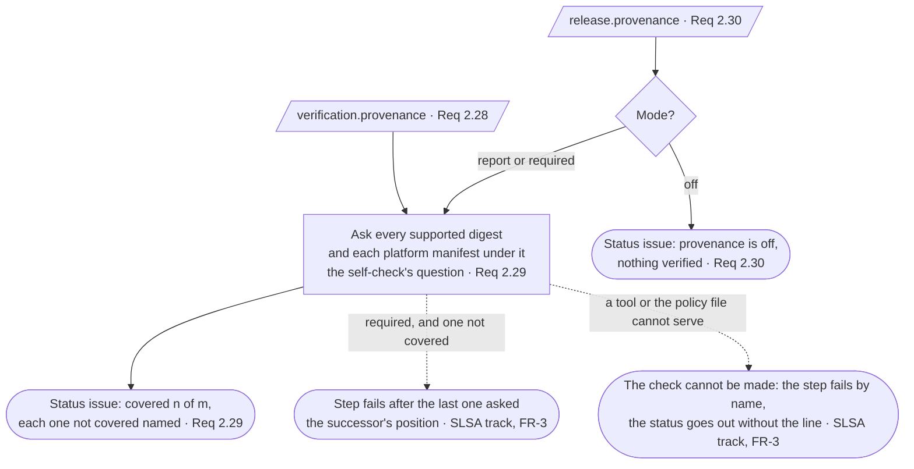

| Step | Runs in | Explained in | Rests on |
|---|---|---|---|
| Ask every reference | [`rescan.yml`](../.github/workflows/rescan.yml), step "provenance coverage over the supported set"; `check-provenance.sh report` or `require` | [provenance coverage in the status](user-manual.md#provenance-coverage-in-the-status) | Req 2.29; an absent statement never fails the run under `report`; what `require` and a check that cannot be made do is the SLSA track's FR-3 ([spec](../conductor/tracks/slsa-build-l2_20261028/spec.md)), the owner's call of 2026-11-19 |
| The status line | `rescan.yml`, step "catalogue status, the clocks over the supported set"; the status tool in [`triage/rescan`](../triage/rescan/) | [the catalogue status issue](user-manual.md#the-catalogue-status-issue) | Req 2.29, 2.30, 6.46, 6.47 |

### For a consumer


| Step | Runs in | Explained in | Rests on |
|---|---|---|---|
| The recipe step | the README's block, rendered by [`render-verification.sh`](../scripts/render-verification.sh) from the declaration | [verify an image](../README.md#verify-an-image) | Req 2.25; ADR 0005, decision 2: a step without the jq half verifies the signer only |
| The smoke test | `rescan.yml`, step "consumer smoke test"; [`consumer-smoke.sh`](../scripts/consumer-smoke.sh) | [reading job summaries](user-manual.md#reading-job-summaries) | Req 9.13; the review of 2026-09-09, finding 2.4: an empty result passed |
| The Kyverno rule | [`policies/verify-catalogue-images.yaml`](../policies/verify-catalogue-images.yaml), rendered only under `required` | [what a provenance statement has to say](user-manual.md#what-a-provenance-statement-has-to-say) | Req 2.28; ADR 0005, amendment: one more attestation of the existing entry |
| The claim | [SECURITY.md](../SECURITY.md#slsa-build-level) | the same | Req 9.19: no level above what the policy demands |

## The daily rescan and triage

This lane keeps watching what is already published. New advisories land against images every day, long after their pull request passed the gate, so once a day at 06:17 UTC, or when the owner dispatches it, `rescan.yml` lists every tag the catalogue serves, scans every platform manifest behind it, and acts on what it finds. It produces four things: today's scan reports and VEX document attested to each digest; `cve` issues opened, closed on evidence and reopened; the "Catalogue status" issue with its clocks, and the catalogue page; and a set of daily checks that fail the run by name when a promise is not kept. It decides nothing itself. A triage decision is a pull request a person writes (an OpenVEX statement, an accepted-risk exception, or a fix), and the next rescan reads it. Issues and clocks cover the supported set, the digests a definition's current tags point to; an older digest a tag still reaches keeps its scans and attestations but holds no issues (Req 6.49). Every step after the scan runs whatever failed above it and refuses by name when its own input is missing (review disposition D1, Decision 6), so a red run names every promise not kept that day. Why the rescan works this way: [the daily rescan](../triage/README.md#the-daily-rescan-req-222-63-642-to-657) in the triage README. Two step names in `rescan.yml` contain a long dash; the tables below print it as a colon.

### Scan, attest, and the issue lifecycle

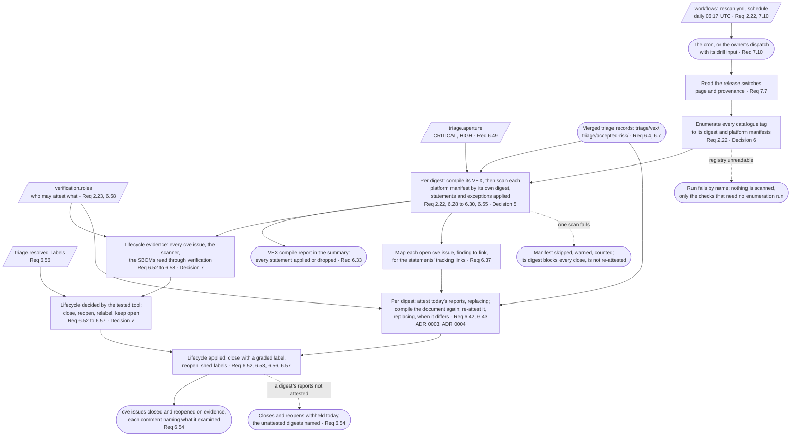

| Step | Runs in | Explained in | Rests on |
|---|---|---|---|
| The schedule | [`rescan.yml`](../.github/workflows/rescan.yml), `cron: "17 6 * * *"`, and the dispatch input `drill`; held equal to the declaration by `validate.yml`, step "workflow schedule + permissions vs policy file (Req 7.10)" | [crons and cadence](user-manual.md#crons-and-cadence) | Req 2.22 (at least once a day), 7.10 |
| Release switches | `rescan.yml`, step "release switches (Req 7.7)"; [`release-policy.sh`](../scripts/release-policy.sh) | [the catalogue page](user-manual.md#the-catalogue-page) | Req 7.7; review D3: a malformed switch fails here by name |
| Enumerate | `rescan.yml`, step "enumerate the catalogue (Req 2.22)"; [`enumerate-catalogue.sh`](../scripts/enumerate-catalogue.sh) | [crons and cadence](user-manual.md#crons-and-cadence) | Req 2.22; Decision 6: the one step that fails hard, a partial list would shrink what is watched |
| Compile and scan | `rescan.yml`, step "scan every platform manifest of every tag-referenced digest"; [`compile-vex.sh`](../scripts/compile-vex.sh), [`scan-image.sh`](../scripts/scan-image.sh) with `--remote` | [what VEX means for you](user-manual.md#what-vex-means-for-you), [reading job summaries](user-manual.md#reading-job-summaries) | Req 2.22, 6.28 to 6.30, 6.55; Decision 5; a failed scan skips one manifest and does not fail the step |
| Lifecycle evidence | `rescan.yml`, step "issue lifecycle, the evidence (Req 6.52 to 6.57)"; [`fetch-sboms.sh`](../scripts/fetch-sboms.sh), [`triage-policy.sh`](../scripts/triage-policy.sh) `resolved-labels` | [rescan CVE issues](user-manual.md#rescan-cve-issues) | Req 6.52 to 6.58; Decision 7 |
| Lifecycle decided | `rescan.yml`, step "issue lifecycle, decided on evidence (tested)"; `cmd/rescan-lifecycle` in [`triage/rescan`](../triage/rescan/) | [rescan CVE issues](user-manual.md#rescan-cve-issues) | Req 6.52 to 6.57; Decision 7 |
| Issue map | `rescan.yml`, step "open cve issues (finding -> issue)" | [rescan CVE issues](user-manual.md#rescan-cve-issues) | Req 6.37: the open issue map is the compiler's fifth input |
| Attest and re-attest | `rescan.yml`, step "attest today's reports, re-attest OpenVEX on change (Req 6.42, 6.43)"; [`reattest.sh`](../scripts/reattest.sh) | [triage README, the daily rescan](../triage/README.md#the-daily-rescan-req-222-63-642-to-657) | Req 6.42, 6.43, 6.58; [ADR 0003](decisions/0003-one-openvex-document-per-digest.md), [ADR 0004](decisions/0004-re-attestation-replaces.md): one document per digest, replaced, never appended |
| Lifecycle applied | `rescan.yml`, step "issue lifecycle, applied (Req 6.52, 6.53, 6.56, 6.57)" | [rescan CVE issues](user-manual.md#rescan-cve-issues) | Req 6.52 to 6.57; Decision 7, review D2: it runs after re-attestation because closes rest on attested reports |
| Compile report | `rescan.yml`, step "summary", the block "VEX compilation (Req 6.28-6.30)"; the step "upload rescan artifacts" keeps every file the run wrote | [reading job summaries](user-manual.md#reading-job-summaries) | Req 6.32, 6.33: "compiled nothing" and "never compiled" stay apart |

### The daily checks

Each check reports by name. A check that does not hold fails the run, but never stops the next one from being made.

```mermaid
%%{init: {"flowchart": {"wrappingWidth": 340}}}%%
flowchart TB
    IN(["Today's enumeration and reports,<br/>from the graph above"])
    FEED[/"triage.kev_feed, triage.drills<br/>Req 6.60, 7.7"/]
    TIERS[/"triage.ceilings, triage.kev_ceiling<br/>Req 6.49, 6.51"/]
    CONS[/"consumers<br/>trivy authoritative, grype · Req 9.11"/]
    WIN[/"triage.expiry_warning<br/>Req 6.10, 6.49"/]
    VIS["Every repository and tag pulls anonymously<br/>Req 2.21 · Decision 6"]
    ADM["The admission policy admits every<br/>tagged digest, rejects the unsigned control<br/>Req 2.24 · Decision 6"]
    DR{"Drill input?"}
    KEV["Fetch the KEV feed, or the drill's substitute<br/>Req 6.60 · Decision 13"]
    TIER["Each unexpired exception against today's<br/>severity and KEV status · Req 6.51 · Decision 7"]
    CNT["Exactly one OpenVEX attestation on every<br/>digest and platform manifest · Req 6.44, 6.45<br/>ADR 0004"]
    AUTH["Each definition's authenticity signal against<br/>its origin; lapsed compat review dates<br/>Req 3.10, 3.13, 4.9 · Decision 8"]
    PORT["VEX portability: each other consumer scans<br/>what Trivy suppressed · Req 9.12 · Decision 10"]
    SMOKE["Consumer smoke test: the README recipe<br/>run verbatim on one supported digest<br/>Req 9.13 · Decision 10"]
    EXP["Accepted-risk expiries: lapsed,<br/>or lapsing within the window · Req 6.10"]
    PROV["Provenance coverage, drawn in<br/>the SLSA provenance lane<br/>Req 2.29, 2.30 · Decision 15"]
    POST["Posture: rulesets equal the live ones,<br/>private reporting on, no tag<br/>on a revoked digest<br/>Req 9.3, 9.7, 9.9 · Decision 10"]
    SCI(["One supply-chain issue per definition,<br/>kept open while the mismatch lasts · Req 3.10"])
    PB(["Portability block in the summary,<br/>never fails the run · Req 9.12"])
    EXPL(["Listed in the summary,<br/>never fails the run · Req 6.10"])
    NOEVAL(["Not evaluated: the run fails by name;<br/>no issue set, status or page today · Req 6.60"])
    RED(["The run fails, naming each check<br/>that did not hold"])
    IN --> VIS & ADM & CNT & PORT & SMOKE & PROV & POST
    IN --> DR
    FEED --> DR
    DR -->|none: the declared feed| KEV
    DR -->|kev-outage or kev-synthetic| KEV
    KEV --> TIER
    TIERS --> TIER
    CONS --> PORT --> PB
    WIN --> EXP --> EXPL
    KEV -.->|unreachable| NOEVAL
    VIS -.-> RED
    ADM -.-> RED
    TIER -.->|over its tier| RED
    CNT -.-> RED
    AUTH -.->|mismatch| SCI
    AUTH -.->|mismatch, or origin not measured| RED
    SMOKE -.->|a step fails, or a suppression is missing| RED
    POST -.-> RED
```

| Step | Runs in | Explained in | Rests on |
|---|---|---|---|
| Visibility, admission, tiers, count | `rescan.yml`, step "invariants (Req 2.21, 2.24, 6.44, 6.51)"; [`check-visibility.sh`](../scripts/check-visibility.sh), [`verify-catalogue.sh`](../scripts/verify-catalogue.sh), [`check-exceptions.sh`](../scripts/check-exceptions.sh) `rescan`, [`check-attestation-count.sh`](../scripts/check-attestation-count.sh); the four run independently and fail the step together | [reading job summaries](user-manual.md#reading-job-summaries), [policies](user-manual.md#policies) | Req 2.21, 2.24, 6.44, 6.45, 6.51; Decision 6, review D1 |
| The KEV feed and drills | the same step; `triage-policy.sh kev-feed`, or `drill-feed` when the dispatch's `drill` input is not `none` | [crons and cadence](user-manual.md#crons-and-cadence) | Req 6.60: an outage is a failure, not a pass; Decision 13 (live drills, task 16.8) |
| Authenticity | `rescan.yml`, step "authenticity signals (Req 3.10, 3.13, 4.9)"; [`check-authenticity.sh`](../scripts/check-authenticity.sh) | [SECURITY.md, upstream authenticity](../SECURITY.md#upstream-authenticity-per-definition), [handling Renovate PRs](user-manual.md#handling-renovate-prs) | Req 3.10, 3.13, 4.9; Decision 8: an origin that did not answer files no issue |
| Portability | `rescan.yml`, step "VEX portability over the supported set (Req 9.12)", `continue-on-error: true`; [`vex-consumer.sh`](../scripts/vex-consumer.sh), [`vex-portability.sh`](../scripts/vex-portability.sh) | [reading job summaries](user-manual.md#reading-job-summaries) | Req 9.11, 9.12; Decision 10: informational while `consumers.gating` is false |
| Smoke test | `rescan.yml`, step "consumer smoke test (Req 9.13)"; [`consumer-smoke.sh`](../scripts/consumer-smoke.sh) | [reading job summaries](user-manual.md#reading-job-summaries), [verify what you pull](user-manual.md#verify-what-you-pull) | Req 9.13; Decision 10, ADR 0004's `--vex oci` check rides inside it |
| Expiries | `rescan.yml`, step "accepted-risk expiries (Req 6.10)"; [`lint-accepted-risk.sh`](../scripts/lint-accepted-risk.sh) | [expiries](user-manual.md#expiries) | Req 6.10: one implementation of "expired" for the gate and the notice |
| Provenance coverage | `rescan.yml`, step "provenance coverage over the supported set (Req 2.29, 2.30)" | drawn in [SLSA provenance, in the daily rescan](#in-the-daily-rescan) | Req 2.29, 2.30; Decision 15 |
| Posture | `rescan.yml`, step "posture invariants (Req 9.3, 9.7, 9.9)"; [`check-governance.sh`](../scripts/check-governance.sh), [`check-revocations.sh`](../scripts/check-revocations.sh) | [branch protection](user-manual.md#branch-protection), [revoke a digest](user-manual.md#revoke-a-digest) | Req 9.3, 9.7, 9.9; Decision 10: it runs last so a governance failure never starves the issues and status |

### New issues

```mermaid
%%{init: {"flowchart": {"wrappingWidth": 340}}}%%
flowchart TB
    IN(["Today's supported reports and the KEV feed,<br/>from the graphs above"])
    AP[/"triage.aperture<br/>Req 6.49"/]
    ENR["Enrich: EPSS for each CVE, best effort;<br/>KEV from the feed fetched above<br/>Req 6.3, 6.60"]
    DED["Dedup: the ids open cve issues carry<br/>in their hidden marker · Req 6.3"]
    REP["Build the issue set, the tested reporter:<br/>new findings within the aperture<br/>Req 6.3 · Decision 7"]
    ANY{"Any new finding?"}
    GRY["Grype second opinion on each CRITICAL,<br/>in the log · a convention, Req 9.11 to 9.13"]
    FILE["File one issue per new finding: severity,<br/>EPSS, KEV, affected images · Req 6.3"]
    NEW(["New cve issues: a person decides<br/>by pull request, a statement,<br/>an exception or a fix · Req 6.4, 6.5, 6.7"])
    NONE(["Nothing filed"])
    NOSET(["No issue set today, named · Req 6.60"])
    IN --> ENR --> DED --> REP --> ANY
    AP --> REP
    ANY -->|yes| GRY --> FILE --> NEW
    ANY -->|no| NONE
    ENR -.->|no KEV file| NOSET
```

| Step | Runs in | Explained in | Rests on |
|---|---|---|---|
| Enrich | `rescan.yml`, step "enrich: EPSS + CISA KEV"; the EPSS API of FIRST.org, the KEV file the invariants step fetched | [rescan CVE issues](user-manual.md#rescan-cve-issues) | Req 6.3, 6.60: no issue set is built on a KEV status nobody evaluated |
| Dedup | `rescan.yml`, step "dedup: already-open CVE issues" | [rescan CVE issues](user-manual.md#rescan-cve-issues) | Req 6.3; the marker carries the scanner's id, a CVE or a GHSA advisory, never the title |
| Issue set | `rescan.yml`, step "build issue set (tested reporter)"; `cmd/rescan-report` in [`triage/rescan`](../triage/rescan/), reading the supported reports only | [rescan CVE issues](user-manual.md#rescan-cve-issues) | Req 6.3, 6.49; Decision 7: the supported set only |
| Grype | `rescan.yml`, step "Grype second opinion on CRITICAL (convention; Req 9.11 to 9.13)" | [rescan CVE issues](user-manual.md#rescan-cve-issues) | A convention beside the declared consumers of Req 9.11 to 9.13: a second scanner's reading of what is about to be filed, never a gate |
| File | `rescan.yml`, step "file new-CVE issues (Req 6.3)" | [rescan CVE issues](user-manual.md#rescan-cve-issues), [the four treatments](user-manual.md#clearing-a-red-gate--the-four-treatments) | Req 6.3; the decision after it is Req 6.4, 6.5, 6.7 |

### The status issue and the page

```mermaid
%%{init: {"flowchart": {"wrappingWidth": 340}}}%%
flowchart TB
    IN(["Today's attested documents, reports,<br/>KEV feed and checks, from the graphs above"])
    TRI[/"triage: aperture, ceilings, kev_ceiling,<br/>support statement · Req 6.49"/]
    PG[/"release.page<br/>Req 6.61"/]
    PREV["Read the last status issue,<br/>found by its hidden marker · Req 6.46"]
    INACT["No inactive definition gained a digest<br/>or a tag since that status<br/>Req 1.15 · Decision 11"]
    CLK["The clocks over the supported set: first seen,<br/>decided, fixed, age against the ceilings;<br/>the page drawn from the same data<br/>Req 6.46, 6.47, 6.61 · Decision 7, 12"]
    PUB(["The Catalogue status issue, edited in place,<br/>and the catalogue-status artifact · Req 6.47"])
    PON{"Page on?"}
    UP["Upload the page and its data<br/>as a Pages artifact · Req 6.61 · Decision 12"]
    DEP["Job publish the catalogue page:<br/>deploy, then read the data back<br/>until it is this run's · Req 6.61, 6.62"]
    LIVE(["The catalogue page is live"])
    OFF(["No page; the run stays green"])
    NOSTAT(["No status and no page today,<br/>the missing input named · Req 6.46, 6.47"])
    PFAIL(["The page job fails by name · Req 6.62"])
    GAIN(["The run fails, the definition<br/>and tag named · Req 1.15"])
    IN --> PREV --> CLK --> PUB
    PREV --> INACT
    TRI --> CLK
    CLK --> PON
    PG --> PON
    PON -->|yes| UP --> DEP --> LIVE
    PON -->|no| OFF
    PREV -.->|re-attestation failed above| NOSTAT
    CLK -.->|an input missing| NOSTAT
    INACT -.->|a gain| GAIN
    DEP -.->|deploy fails, or old data still served| PFAIL
```

| Step | Runs in | Explained in | Rests on |
|---|---|---|---|
| Last status | `rescan.yml`, step "catalogue status, the previously published data (Req 6.46)"; runs only when re-attestation succeeded | [the catalogue status issue](user-manual.md#the-catalogue-status-issue) | Req 6.46: its fenced JSON carries the fix dates forward |
| Inactive definitions | `rescan.yml`, step "no inactive definition gained a digest or a tag (Req 1.15)"; [`check-inactive-digests.sh`](../scripts/check-inactive-digests.sh) | [deactivate a definition](user-manual.md#deactivate-a-definition) | Req 1.15; Decision 11, review D7: the detective half, `build.yml` holds the preventive one |
| The clocks | `rescan.yml`, step "catalogue status, the clocks over the supported set (Req 6.46)"; `cmd/rescan-status` in [`triage/rescan`](../triage/rescan/); it needs the KEV file, the revocation record, the admission proof and the expiry report, and adds the provenance line when one was measured | [the catalogue status issue](user-manual.md#the-catalogue-status-issue), [the catalogue page](user-manual.md#the-catalogue-page) | Req 6.46, 6.47, 6.49, 6.61, and the provenance line of Req 2.29, 2.30; Decision 7, 12 |
| Publish | `rescan.yml`, steps "catalogue status, published to the status issue (Req 6.47)" and "upload the status data (Req 6.47)" | [the catalogue status issue](user-manual.md#the-catalogue-status-issue) | Req 6.47 |
| Page | `rescan.yml`, step "upload the catalogue page (Req 6.61)"; the job "publish the catalogue page", steps "deploy the catalogue page (Req 6.61)" and "the served status data is this run's (Req 6.62)" | [the catalogue page](user-manual.md#the-catalogue-page) | Req 6.61, 6.62; Decision 12: an artifact, never a commit, and that job alone holds `pages: write` |

## Posture: rulesets, reporting, revocations

This lane keeps the catalogue's trust statement, [SECURITY.md](../SECURITY.md), true after it was written. Three promises in it can quietly stop being kept: the ruleset on `main` can be changed in GitHub's settings, private vulnerability reporting can be switched off, and a revoked digest can still sit under a tag. So the daily rescan checks all three in one step, "posture invariants", the last check of the run; it runs whatever failed above it, so a governance failure never keeps the day's issues and status from going out (Decision 6, review disposition D1). Its reads are anonymous, with no token, so it sees what any consumer sees. The revocation record itself is written by hand when the owner revokes a digest, and `validate` checks its shape on every pull request. The lane produces summary lines, entries in the status issue, and a failed run naming each promise not kept. It reads no value from `catalogue-policy.yaml`, so its graphs have no slanted boxes; its inputs are records committed in the repository, drawn as rounded boxes. Why this lane exists: Decision 10.

### Rulesets and private reporting

```mermaid
%%{init: {"flowchart": {"wrappingWidth": 340}}}%%
flowchart TB
    IN(["The daily rescan, 06:17 UTC or dispatched;<br/>this step runs last, whatever failed above"])
    RS(["The committed ruleset export<br/>.github/rulesets/main_sec.json · Req 9.8"])
    REP["Read whether private vulnerability<br/>reporting is on, anonymously;<br/>a rate-limited read waits for the reset<br/>Req 9.2, 9.3 · Decision 10"]
    ON{"Enabled?"}
    LIVE["Read the live rulesets, anonymously;<br/>a rate-limited read waits for the reset;<br/>match each committed one by name<br/>Req 9.9 · Decision 10"]
    CMP["Compare name, target, enforcement,<br/>conditions and rules, in both directions;<br/>bypass actors left out, anonymous reads<br/>withhold them · Req 9.9 · Decision 10"]
    DIFF{"A difference, a committed ruleset<br/>with no live one, or an active live<br/>branch ruleset not committed?"}
    DIS(["The run fails: reporting disabled<br/>or unreadable, named · Req 9.3"])
    RED(["The run fails, each ruleset<br/>failure named · Req 9.9"])
    OK(["Summary: reporting enabled, n rulesets<br/>compared, 0 differences, 0 live-only;<br/>the step passes when both hold"])
    IN --> REP & LIVE
    REP --> ON
    RS --> CMP
    LIVE --> CMP --> DIFF
    ON -->|yes| OK
    DIFF -->|no| OK
    ON -.->|no| DIS
    REP -.->|unreadable, or still rate limited| DIS
    LIVE -.->|unreadable, or still rate limited| RED
    DIFF -.->|yes| RED
```

The two reads do not depend on each other: a failed or disabled first read does not stop the second, and the step names every failure of the day. A rate-limited read waits for the reset GitHub names (at most 3900 seconds, twice per read) and is made again, still anonymously; a read that stays limited, or fails for any other reason, fails the run, named "unreadable".

| Step | Runs in | Explained in | Rests on |
|---|---|---|---|
| The trigger | [`rescan.yml`](../.github/workflows/rescan.yml), step "posture invariants (Req 9.3, 9.7, 9.9)", `if: always()` | [the daily rescan and triage](#the-daily-rescan-and-triage) | Decision 6, the D1 correction: placed last so it never starves the issues and status |
| The committed export | [`.github/rulesets/main_sec.json`](../.github/rulesets/main_sec.json), GitHub's own export format; no workflow step checks which checks it requires, a person keeps it in line | [branch protection](user-manual.md#branch-protection) | Req 9.8; Decision 10 |
| Private reporting | the same step; [`check-governance.sh`](../scripts/check-governance.sh), the read of `private-vulnerability-reporting` | [SECURITY.md, reporting a vulnerability](../SECURITY.md#reporting-a-vulnerability) | Req 9.2, 9.3; Decision 10 |
| Live rulesets and the comparison | the same step and script, the reads of `rulesets` and of each matched ruleset by id; its tests: [`validate.yml`](../.github/workflows/validate.yml), step "check-governance unit tests (Req 9.3, 9.9)" | [branch protection](user-manual.md#branch-protection), [SECURITY.md, governance](../SECURITY.md#governance-one-maintainer-the-bypass-kept-in-force) | Req 9.9; Decision 10: bypass actors are carried by the export and stated in SECURITY.md instead |
| The rate-limit wait | the same script, `DHC_GOVERNANCE_MAX_WAIT` (3900 seconds by default) | [branch protection](user-manual.md#branch-protection) | Req 9.9 says "through anonymous reads", so the token is not used as a fallback; on such a day the rescan can take about an hour longer |
| The summary line | `rescan.yml`, step "summary", the line "governance:" | [reading job summaries](user-manual.md#reading-job-summaries) | Req 9.3, 9.9 |

### A revocation, by hand

A revocation is the owner's decision that a published digest must not be pulled any more. The registry (GHCR) has no way to delete one tag: a tag goes either with its whole package version or when another image is pushed under it. So there are two moves, and both end in one entry in [`triage/revocations.yaml`](../triage/revocations.yaml).

```mermaid
%%{init: {"flowchart": {"wrappingWidth": 340}}}%%
flowchart TB
    DEC(["The owner decides a published digest<br/>must not be pulled · register row M14"])
    CAN{"Can a fixed definition ship?"}
    MA["Move A: fix the definition by pull request;<br/>the release moves its three tags<br/>to the new digest · Req 2.7 to 2.9"]
    MB["Move B1: the owner deletes<br/>the package version, and every<br/>tag on it goes too · Req 9.5 · Decision 10"]
    ADV["Draft the advisory, a GitHub repository<br/>security advisory · Req 9.4 · Decision 10"]
    ENT["Add one entry by pull request: replaced,<br/>or withdrawn with the move taken;<br/>nothing is ever removed · Req 9.5 · Decision 10"]
    SCH["validate: the record fits its schema<br/>Req 9.6"]
    DONE(["Entry merged, advisory published;<br/>the daily rescan checks it from now on"])
    SFAIL(["validate fails, naming the entry and the field<br/>Req 9.6"])
    DEC --> CAN
    CAN -->|yes| MA --> ADV
    CAN -->|no| MB --> ADV
    ADV --> ENT --> SCH --> DONE
    SCH -.->|does not fit| SFAIL
```

| Step | Runs in | Explained in | Rests on |
|---|---|---|---|
| The decision | by hand, the owner | [revoke a digest](user-manual.md#revoke-a-digest), [what GHCR can and cannot do](user-manual.md#what-ghcr-can-and-cannot-do) | Req 9.5; the manual-controls register in [CONVENTIONS.md](CONVENTIONS.md), row M14 |
| Move A | the [release](#the-release): `build.yml`, step "apply definition-derived tags" | [move A](user-manual.md#move-a-replacement-through-the-release-path) | Req 2.7 to 2.9: the revoked digest is left untagged, which is frozen (Req 2.11) |
| Move B1 | by hand: `gh api -X DELETE` on the package version; GitHub refuses it for a public version past 5,000 downloads | [move B](user-manual.md#move-b-withdrawal-nothing-replaces-it) | Req 9.5; Decision 10. Move B2, parking the tags on a signed "tombstone" image, is described in the manual and not built |
| The advisory | by hand, on the repository's Security tab | [then, whichever move](user-manual.md#then-whichever-move), [SECURITY.md, advisories](../SECURITY.md#advisories) | Req 9.4; Decision 10 |
| The entry | a pull request to `triage/revocations.yaml` | [SECURITY.md, revocation](../SECURITY.md#revocation) | Req 9.5; Decision 10: the record drives the mechanics, so the runbook stays short |
| The schema | `validate.yml`, step "revocation record (Req 9.6)": `yamale` against [`revocations.schema.yaml`](../triage/revocations.schema.yaml) | [then, whichever move](user-manual.md#then-whichever-move) | Req 9.6 |

### The daily revocation check

The rescan reads the record twice. The invariants step reads it into the list the status issue shows, and ignores the verdict there; the posture step, last, reads it again and gives the verdict, so a revocation that was only half done fails the run after the day's issues and status are out, not instead of them.

```mermaid
%%{init: {"flowchart": {"wrappingWidth": 340}}}%%
flowchart TB
    REC(["The merged record<br/>triage/revocations.yaml · Req 9.5"])
    ENUM(["Today's enumeration: every catalogue tag,<br/>its digest and platform manifests · Req 2.22"])
    READ["invariants step: read the record<br/>into the status list, verdict ignored<br/>Req 9.5 · Decision 10"]
    LIST(["The status issue lists every entry<br/>Req 6.46"])
    HAS{"Enumeration present?"}
    VERD["posture step: match every recorded digest<br/>against each tag's index and platform manifests<br/>Req 9.7 · Decision 10"]
    REF{"A tag still on a revoked digest?"}
    OK(["Summary: n recorded,<br/>0 still referenced"])
    TAGRED(["The run fails, one line per tag: the digest,<br/>the platform, the date, the advisory · Req 9.7"])
    NOENUM(["The run fails by name:<br/>the verdict not asserted today · Req 9.7"])
    UNREAD(["Record unreadable or no list:<br/>the run fails by name"])
    ENUM --> READ --> LIST
    REC --> READ
    ENUM --> HAS
    HAS -->|yes| VERD --> REF
    REC --> VERD
    REF -->|no| OK
    REF -.->|yes| TAGRED
    HAS -.->|no| NOENUM
    VERD -.-> UNREAD
```

| Step | Runs in | Explained in | Rests on |
|---|---|---|---|
| The enumeration | `rescan.yml`, step "enumerate the catalogue (Req 2.22)" | [the daily rescan and triage](#scan-attest-and-the-issue-lifecycle) | Req 2.22; Decision 6 |
| The status list | `rescan.yml`, step "invariants (Req 2.21, 2.24, 6.44, 6.51)", [`check-revocations.sh`](../scripts/check-revocations.sh) with `\|\| true`; then step "catalogue status, the clocks over the supported set (Req 6.46)", which publishes no status when the list is missing | [the catalogue status issue](user-manual.md#the-catalogue-status-issue) | Req 9.5, 6.46; Decision 10 |
| The verdict | `rescan.yml`, step "posture invariants (Req 9.3, 9.7, 9.9)", `check-revocations.sh` again; its tests: `validate.yml`, step "check-revocations unit tests (Req 9.5 to 9.7)" | [revoke a digest](user-manual.md#revoke-a-digest) | Req 9.7; Decision 10, as built: in the posture step rather than the invariants step |
| The summary line | `rescan.yml`, step "summary", the line "revocations:" | [reading job summaries](user-manual.md#reading-job-summaries) | Req 9.7 |
