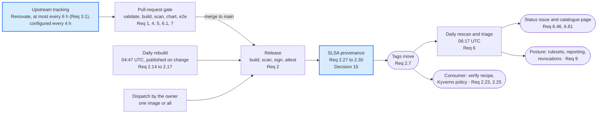
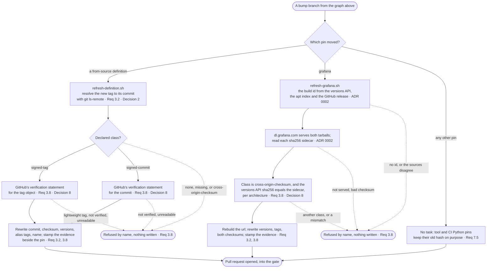
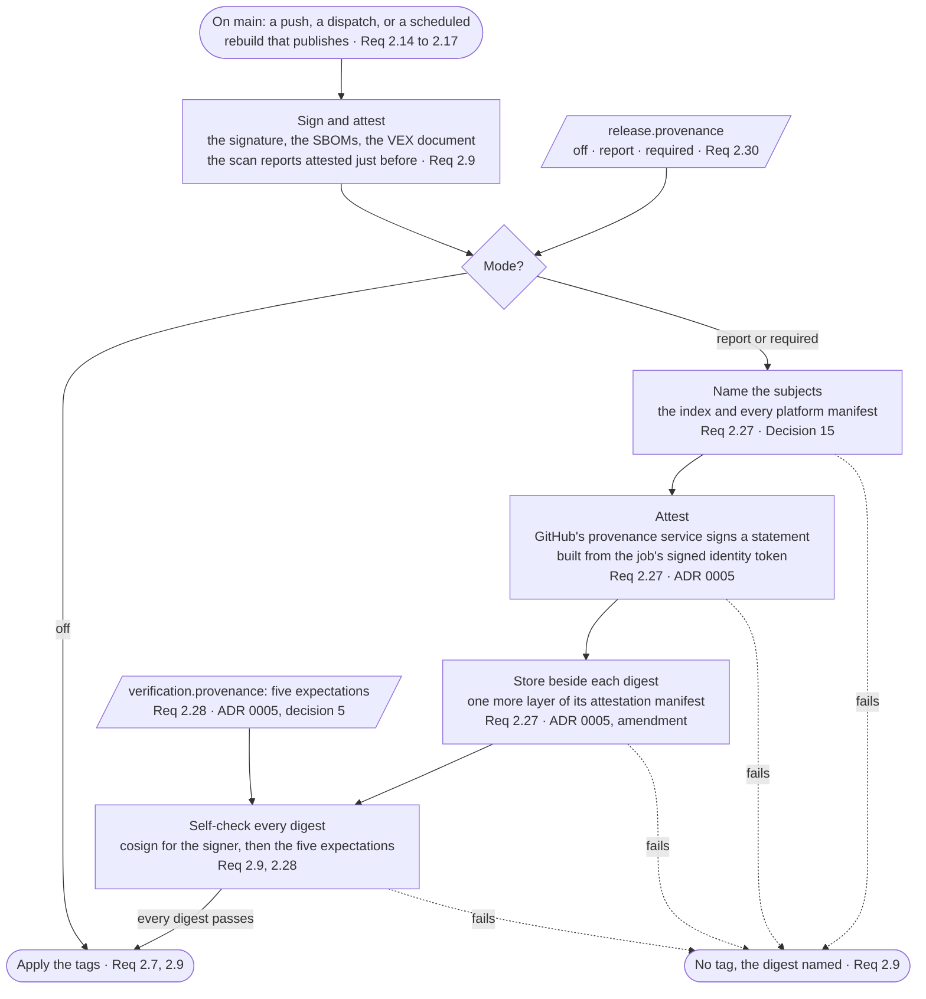

# The lanes: what runs, and why

The catalogue is a set of lanes: each is one path work takes through the repository, from a trigger to a published result. This page draws each lane once. A box is a step; its label names the requirement it fulfils (`Req n.m`, in [requirements.md](../.specs/dhc-catalogue-mvp/requirements.md)) and the design decision or ADR it rests on (`Decision n` in [design.md](../.specs/dhc-catalogue-mvp/design.md#key-design-decisions), ADRs in [docs/decisions/](decisions/)). A slanted box is a value declared in `catalogue-policy.yaml`, a diamond a branch on such a value, a rounded box an outcome. The table under each graph says where each step runs and where it is explained. GitHub draws the graphs; their text is in this file and changes in the pull request that changes the lane (Req 9.21).

## The lane map

How the lanes connect. The lanes not yet drawn below are drawn in the next steps of the documentation track; until then the [manual](user-manual.md#part-ii-the-pipeline) explains them.

## Upstream tracking

This lane turns a new upstream release into a pull request, so nobody has to watch upstream by hand. Renovate (a bot that reads version pins and proposes updates) runs self-hosted in GitHub Actions every 4 hours, or when the owner dispatches it. It reads every pin in the repository, holds back what is too young or too big to offer, makes each bumped definition consistent again with a refresh script, and opens a pull request. That pull request then enters the [pull-request gate](user-manual.md#part-ii-the-pipeline) like any other change. Why Renovate and not a custom tracker: Decision 2. How much to trust an upstream release: Decision 8 and, for grafana, [ADR 0002](decisions/0002-grafana-upstream-tracking.md). Renovate cannot read `catalogue-policy.yaml`, so the two policy values it depends on reach it through a lint and a rendered block in `renovate.json5`.

### What is offered

| Step | Runs in | Explained in | Rests on |
|---|---|---|---|
| The schedule | [`renovate.yml`](../.github/workflows/renovate.yml), `cron: "0 */4 * * *"`; held equal to the declaration by [`validate.yml`](../.github/workflows/validate.yml), step "workflow schedule + permissions vs policy file (Req 7.10)", [`lint-workflow-policy.sh`](../scripts/lint-workflow-policy.sh) | [crons and cadence](user-manual.md#crons-and-cadence) | Req 3.1 (at most 6 h; 4 h leaves margin for GitHub's scheduler delay), 7.10 |
| The tracking scope | [`render-tracking.sh`](../scripts/render-tracking.sh), run by whoever edits the active set; `validate.yml`, step "tracking scope rendering drift check (Req 1.14)" | [deactivate a definition](user-manual.md#deactivate-a-definition), [Renovate managers](user-manual.md#renovate-managers) | Req 1.13, 1.14; Decision 11 |
| Renovate runs | `renovate.yml`, its one step, which has no `name:`: `renovatebot/github-action` v43.0.9, pinned by commit; the managers in [`renovate.json5`](../renovate.json5) | [Renovate managers](user-manual.md#renovate-managers) | Req 3.1; Decision 2 |
| The age | `renovate.json5`, the rule with `minimumReleaseAge: "3 days"` and `timestamp-required` over github-tags, github-releases, npm, pypi, helm and go | [handling Renovate PRs](user-manual.md#handling-renovate-prs) | Req 3.7; Decision 8 (a): docker is exempt, it carries the catalogue's own digests and the hand-reviewed build layer |
| The dashboard | `renovate.json5`, the rules with `dependencyDashboardApproval: true`: every major, and every grafana minor | [handling Renovate PRs](user-manual.md#handling-renovate-prs) | Req 3.4; Decision 2: grafana rides the stable maintenance line, a minor is the owner's call (register row M24) |
| The grouping | `renovate.json5`, the three rules with a `groupName` naming one upstream | [Renovate managers](user-manual.md#renovate-managers) | Req 3.3 |
| The vulnerability alert | `renovate.json5`, `vulnerabilityAlerts: { enabled: true }` | [Renovate managers](user-manual.md#renovate-managers) | Req 3.14, 3.15: a dismissal in GitHub is the not-affected record for the repository's own dependencies |

### A bump made consistent

Renovate moves one value, the version. Every field derived from it (commit, checksum, tags, name) is then stale, so a script Renovate runs after the bump (a `postUpgradeTask`) rewrites them. Before it writes anything it checks the authenticity signal the definition declares in its `# authenticity:` comment, and a failed check writes nothing.

| Step | Runs in | Explained in | Rests on |
|---|---|---|---|
| Which pin moved | `renovate.json5`, the two `postUpgradeTasks` rules: one keyed on the github-tags datasource, one on the name `grafana/grafana`; both commands allowlisted in `renovate.yml` (`RENOVATE_ALLOWED_POST_UPGRADE_COMMANDS`) | [Renovate managers](user-manual.md#renovate-managers) | Decision 2: the two definition archetypes, compile-from-source and tarball-repackage |
| From-source refresh | [`refresh-definition.sh`](../scripts/refresh-definition.sh), inside the Renovate run; its tests: `validate.yml`, step "refresh-definition unit tests (postUpgradeTask, Req 3.2)" | [handling Renovate PRs](user-manual.md#handling-renovate-prs) | Req 3.2, 3.8; Decision 8 (b) |
| Grafana refresh | [`refresh-grafana.sh`](../scripts/refresh-grafana.sh), inside the Renovate run; its tests: `validate.yml`, step "refresh-grafana unit tests (postUpgradeTask, ADR 0002)" | [handling Renovate PRs](user-manual.md#handling-renovate-prs) (with the corner case of a build id no index carries yet, register M11) | Req 3.2, 3.8; ADR 0002 and its amendments of 2026-08-07, 2026-08-11 and 2026-08-25 |
| No task | the pin-script, Python and workflow-pin managers in `renovate.json5` | [handling Renovate PRs](user-manual.md#handling-renovate-prs): completing a tool-pin bump (register M1) | Req 7.5: a checksum that updates itself verifies nothing |

### Merged by a machine, or by the owner

| Step | Runs in | Explained in | Rests on |
|---|---|---|---|
| From-source automerge | `renovate.json5`, the rule `matchDatasources: ["github-tags"]` with `matchUpdateTypes: ["patch", "digest"]`; the later rule `matchManagers: ["github-actions"]` takes Actions back out | [handling Renovate PRs](user-manual.md#handling-renovate-prs) | Req 3.5; Decision 2: Actions are third-party code holding the workflow's token (review D4) |
| Chart digest automerge | `renovate.json5`, the rule over `ghcr.io/mm-weber/dhc/**` with `matchUpdateTypes: ["digest"]`, ordered before the build-layer rule | [handling Renovate PRs](user-manual.md#handling-renovate-prs) | Req 3.12; Decision 8 (c) |
| Reviewed | `renovate.json5`, `automerge: false` on grafana, the helm datasource, the build layer and the Actions manager; no automerge rule reaches the rest | [handling Renovate PRs](user-manual.md#handling-renovate-prs) | Req 3.11; Decision 2: a repackage bump swaps a binary this repository did not build |

## SLSA provenance

A provenance statement says who built a digest, from which repository, workflow file, branch and commit. Since 2026-11-18 every release made while the provenance mode is not `off` carries one beside the index and each platform manifest, generated and signed by GitHub's provenance service rather than written by the job, and the release checks it before any tag moves. These steps run only on `main`, after a push, a dispatch, or a scheduled rebuild that found a change and publishes; a pull request and a scheduled rebuild that publishes nothing never reach them. What it is for and the level claimed: [SECURITY.md](../SECURITY.md#slsa-build-level). The choice of service, verifier and storage: Decision 15 and [ADR 0005](decisions/0005-slsa-provenance-verifier.md). One switch, `release.provenance`, decides how much of the lane runs: `report` here, `required` in the successor, `off` for a repository GitHub offers no attestations to.

### At release

| Step | Runs in | Explained in | Rests on |
|---|---|---|---|
| Name the subjects | [`build.yml`](../.github/workflows/build.yml), step "name the provenance subjects"; [`unpack-provenance.sh subjects`](../scripts/unpack-provenance.sh) | [the release path](user-manual.md#the-release-path-merge-to-main-the-nightly-or-a-dispatch) | Req 2.27; Decision 15 |
| Attest | `build.yml`, step "attest provenance for the index and every platform manifest"; `actions/attest-build-provenance`, pinned by commit | [ADR 0005](decisions/0005-slsa-provenance-verifier.md) | Req 2.27; Decision 15, option B |
| Store | `build.yml`, step "store the provenance beside each digest"; [`unpack-provenance.sh store`](../scripts/unpack-provenance.sh) | [a release stopped at the provenance steps](user-manual.md#a-release-stopped-at-the-provenance-steps) | Req 2.27; ADR 0005, amendment of 2026-11-13: no bundle beside a digest, it hid the other attestations from cosign |
| Self-check | `build.yml`, step "verify the provenance of each digest"; [`check-provenance.sh verify`](../scripts/check-provenance.sh) | [what a provenance statement has to say](user-manual.md#what-a-provenance-statement-has-to-say) | Req 2.9, 2.28; ADR 0005, decisions 2 and 5 |
| Tags, or none | `build.yml`, step "apply definition-derived tags" | [the release path](user-manual.md#the-release-path-merge-to-main-the-nightly-or-a-dispatch) | Req 2.7, 2.9: any failure above moves no tag, consumers keep the previous digest |

### In the daily rescan

| Step | Runs in | Explained in | Rests on |
|---|---|---|---|
| Ask every reference | [`rescan.yml`](../.github/workflows/rescan.yml), step "provenance coverage over the supported set"; `check-provenance.sh report` or `require` | [provenance coverage in the status](user-manual.md#provenance-coverage-in-the-status) | Req 2.29; an absent statement never fails the run under `report`; what `require` and a check that cannot be made do is the SLSA track's FR-3 ([spec](../conductor/tracks/slsa-build-l2_20261028/spec.md)), the owner's call of 2026-11-19 |
| The status line | `rescan.yml`, step "catalogue status, the clocks over the supported set"; the status tool in [`triage/rescan`](../triage/rescan/) | [the catalogue status issue](user-manual.md#the-catalogue-status-issue) | Req 2.29, 2.30, 6.46, 6.47 |

### For a consumer

| Step | Runs in | Explained in | Rests on |
|---|---|---|---|
| The recipe step | the README's block, rendered by [`render-verification.sh`](../scripts/render-verification.sh) from the declaration | [verify an image](../README.md#verify-an-image) | Req 2.25; ADR 0005, decision 2: a step without the jq half verifies the signer only |
| The smoke test | `rescan.yml`, step "consumer smoke test"; [`consumer-smoke.sh`](../scripts/consumer-smoke.sh) | [reading job summaries](user-manual.md#reading-job-summaries) | Req 9.13; the review of 2026-09-09, finding 2.4: an empty result passed |
| The Kyverno rule | [`policies/verify-catalogue-images.yaml`](../policies/verify-catalogue-images.yaml), rendered only under `required` | [what a provenance statement has to say](user-manual.md#what-a-provenance-statement-has-to-say) | Req 2.28; ADR 0005, amendment: one more attestation of the existing entry |
| The claim | [SECURITY.md](../SECURITY.md#slsa-build-level) | the same | Req 9.19: no level above what the policy demands |
